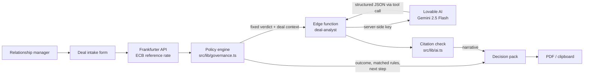

# FX Deal Desk Assistant

**AI decision support for FX request intake, with policy guardrails the model can't override.**

**Live demo:** https://fx-deal-genius.lovable.app

A relationship manager logs a customer's FX request. The app enriches it with a live ECB reference rate, checks it against the bank's FX governance policy, and produces a decision pack: business value, risks, a recommended next step, questions to put to the customer, and a governance outcome that cites specific policy rules. The pack exports to PDF or plain text.

Norton Bank is a fictional bank used for the demo.

---

## Why it exists

At a lot of banks, FX request intake still runs on email, spreadsheets and copy-paste. An RM gets a rough request, looks up a rate, works out whether the deal needs Treasury or Compliance, and writes it up for the desk. Each step is slow, inconsistent and hard to audit.

This prototype covers that whole workflow and shows a pattern that generalises beyond FX:

> **Structured intake → live data → deterministic policy check → LLM narrative → human decision**

## The design choice that matters

The LLM does **not** make decisions. The bank's policy does.

| Decided by the **policy engine** (code) | Drafted by the **LLM** |
|---|---|
| GBP-equivalent notional | Relationship and business value |
| Which policy rules apply | Risk considerations specific to the deal |
| Outcome (Approved / Treasury / Compliance / More info / Enhanced) | Questions the RM should ask the customer |
| Deal status and recommended next step | Plain-English explanation of the outcome |

Guardrails:

- **Thresholds live in one place** (`REVIEW_THRESHOLDS_GBP`), so the status, the governance check, the next step and the exports can never disagree.
- **The model receives the engine's verdict as fixed input** and is told not to contradict it.
- **Citations are validated.** If the model cites a policy rule the engine didn't match, its explanation is thrown away and the engine's own wording is used.
- **The policy pack is held on the server.** The browser can't change what the model is told the rules are.
- **Customer free text is length-capped and marked as data**, which defends against prompt injection through the notes field.
- **There's always a fallback.** If the AI call fails, the app shows a complete rule-based pack. Every section is labelled *AI-drafted*, *Rule-based* or *Policy engine*.

## Architecture



| Layer | Choice |
|---|---|
| Frontend | React, TanStack Start, Tailwind, shadcn/ui |
| FX data | [Frankfurter](https://frankfurter.dev) (ECB reference rates), with a labelled fallback table |
| Policy engine | Deterministic TypeScript, `src/lib/governance.ts` |
| LLM | Lovable AI gateway (Gemini 2.5 Flash), structured output via tool calling |
| AI runtime | Supabase edge function (`supabase/functions/deal-analyst`) |
| Storage | Browser `localStorage`, per visitor |
| Export | jsPDF |

## Try it

Open the [live demo](https://fx-deal-genius.lovable.app) and click one of the **Try an example** buttons:

1. **Routine supplier payment.** £400k, complete context → *Approved for Indicative Review*
2. **Large, urgent energy deal.** £6m, high urgency, top-tier client → *Needs Compliance Review* (P1, P2, P4, P10)
3. **Missing customer context.** No notes captured → *Needs More Information* (P5)

## Prototype vs production

The app includes a **Security & Production Readiness** panel that sets out what the demo does today next to what an enterprise rollout would need, and who usually owns each item: SSO and RBAC, an immutable audit trail for MiFID II record-keeping, a licensed tradeable rate feed, data residency, hosting, AI model governance and compliance sign-off.

Nothing here is executable. Rates are ECB reference rates, labelled as indicative throughout.

## Project structure

```
src/
  lib/
    governance.ts      Policy pack, thresholds, rules engine
    deal-analysis.ts   Status, next step, rule-based narrative, buildPack()
    ai.ts              Calls the edge function, validates the output
    fx.ts              Frankfurter client + fallback rates
    scenarios.ts       Example deals and first-visit sample data
    storage.ts         Per-visitor localStorage persistence
    deal-export.ts     PDF and plain-text decision pack
  components/fx/       Form, decision pack, table, readiness panels
  routes/index.tsx     The single-page app
supabase/functions/
  deal-analyst/        LLM drafting with server-held policy and key
```

## Running locally

```sh
bun install
bun run dev
```

The AI drafting needs a `LOVABLE_API_KEY` in the edge function environment. Without it, the app falls back to the rule-based pack.

---

Built with [Lovable](https://lovable.dev) and [Claude](https://claude.ai). Changes pushed to `main` sync back to the Lovable project.
